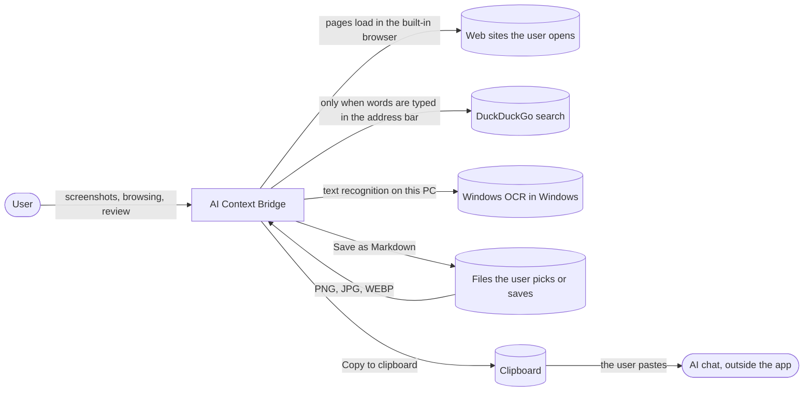
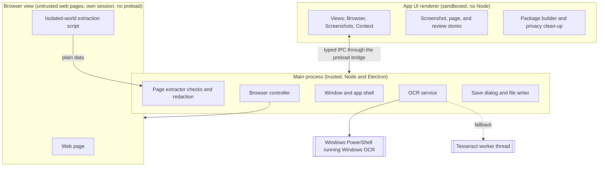
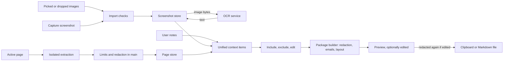

# Architecture

The system-level, high-level design (HLD) of AI Context Bridge: what the parts are, where they
run, how data moves, and where the trust boundaries sit. It names components, not code; each
component's details live in its [system doc](./_systems/README.md). Task status lives in the
[task index](./README.md), not here.

## Context / Problem

A user wants an AI chat to understand what is on their screen: dashboards, reports, web pages,
and the data behind them. Free chats limit image uploads and context size, and pasting raw pages
leaks tokens and personal data. AI Context Bridge collects screenshots and web page content
locally, turns them into text, lets the user review and trim everything, and produces one
Markdown package to paste. See the [product brief](./PRODUCT_BRIEF.md).

## Goals / Non-goals

### Goals

- Collect context from screenshots, the active built-in browser page, and (planned) its API
  responses, with every fact traceable to its source.
- Do all processing on the user's PC: no cloud backend, no AI API, no telemetry.
- Keep secrets and personal data out of the package by default, and let the user review, edit,
  leave out, and remove everything before it leaves the app.
- Produce one package that fits the chat it is pasted into.
- Feel like a finished, polished desktop app on Windows.

### Non-goals

- Calling an AI model or analysing content automatically; the user pastes the package themselves.
- Capturing other apps, other browser tabs, or the whole screen.
- Saving collected data between app runs (only the browser's cookies persist; see Data at rest).
- macOS or Linux builds, browser extensions, and multi-tab browsing in the MVP.

## Technology

Electron 45 hosts the app and the built-in browser; React 19 and TypeScript 7 render the UI;
electron-vite builds it and electron-builder packages an NSIS installer for Windows x64. The
handoff's Tauri and WebView2 plan was replaced after the feasibility check; see
[ADR 0001](./decisions/0001-stack-selection.md). The feasibility spike proved the network capture
path, response bodies, DOM extraction, and isolation ([browser capture](./_systems/browser-capture.md)).

## System context

The app opens no network connections of its own: the only traffic is the pages the user browses
and DuckDuckGo searches typed in the address bar. Nothing is sent to an AI service.

## Processes and trust boundaries

| Boundary | Rule |
|---|---|
| Renderer to main | Every IPC payload is untrusted and checked in main; main never opens a file path the renderer sends. |
| App UI | Context isolation, sandbox, no Node, no webview tag; a Content Security Policy allows only the app's own scripts. |
| Browser view | Web pages get no preload and no bridge, run in their own persistent session, load only http and https, and cannot open windows, download files, or get permissions. |
| Extraction script | Runs in an isolated world, so page scripts cannot change what it reads; its output is checked again in main. |
| OCR helpers | Windows OCR runs in a short-lived PowerShell process on a temporary copy that is deleted afterwards; Tesseract runs in a worker thread with a bundled model and no network. |

Details: [app shell](./_systems/app-shell.md), [browser](./_systems/browser.md).

## Components

| Component | Runs in | Responsibility | System doc |
|---|---|---|---|
| Window and app shell | Main | Window with hidden title bar and caption button overlay, Mica, app icon, IPC registration | [app-shell](./_systems/app-shell.md), [ui-design](./_systems/ui-design.md) |
| Browser controller | Main | One browser view per window, address rules, navigation, page state events, page capture | [browser](./_systems/browser.md) |
| Page extractor | Browser view, then main | Reads headings, text, lists, tables, and selection; main limits, renders Markdown, and redacts | [page-content](./_systems/page-content.md) |
| OCR service | Main | One job at a time; Windows OCR first, Tesseract fallback | [ocr](./_systems/ocr.md) |
| Save service | Main | Save dialog in Documents and file write | [context-package](./_systems/context-package.md) |
| Screenshot store | Renderer | Import checks, thumbnails, order, OCR text by screenshot | [screenshots](./_systems/screenshots.md) |
| Page store | Renderer | Extracted pages with editable text | [page-content](./_systems/page-content.md) |
| Context review | Renderer | Unified item list, include and exclude, notes, export mode, edited package | [context-package](./_systems/context-package.md) |
| Package builder | Renderer | Detailed and compact Markdown, provenance, redaction, email hiding, privacy report | [context-package](./_systems/context-package.md) |
| UI shell and design system | Renderer | Sidebar, toolbars, controls, light and dark themes | [ui-design](./_systems/ui-design.md) |

## Data flow

1. **Screenshots:** files are checked by signature, header size, and decoding before they join
   the list; browser captures go through the same checks with their source page attached.
2. **Text from screenshots:** the renderer sends image bytes; main checks them, runs Windows OCR
   on a temporary copy, falls back to Tesseract when Windows OCR fails, and returns the text.
3. **Page content:** an isolated-world script reads the rendered main content; main checks the
   result, applies the limits, renders Markdown, and redacts secrets before the renderer sees it.
4. **Review:** every source becomes a context item with an include switch; the user edits text,
   adds notes, and leaves items out.
5. **Export:** the package builder redacts secrets in every source, hides email addresses by
   default, strips query strings from links, fences page text as data, and lays out the detailed
   or compact package; edited package text is redacted again on copy and save.

## Data at rest

| Data | Where | Lifetime |
|---|---|---|
| Screenshots, OCR text, pages, notes, review choices | Renderer memory | Until the app closes |
| Images being read by Windows OCR | A private temporary folder | Deleted after each job |
| Browser cookies and site storage | The browser view's persistent session in the app's user data | Until the user clears them (a clear action is planned) |
| Saved packages | Where the user saves them | The user's files |

## Security and privacy

The rules in [PRIVACY.md](./PRIVACY.md) map onto the design like this:

- **Explicit action:** nothing is collected until the user imports, captures, or extracts; network
  capture will need an explicit start and stop with a visible indicator.
- **Active page only:** one browser view, popups open in the same view, and only it is read.
- **Secrets never exported:** page text is redacted in main at extraction; the package builder
  redacts every source at export, and edited text again on copy and save; links lose their
  query strings.
- **Personal data:** email addresses are hidden by default, with an option to keep them.
- **Untrusted content:** page text is fenced and labelled as data, never treated as instructions.
- **User control:** everything can be reviewed, edited, left out, or removed before export.

## Quality attributes and limits

| Area | Design |
|---|---|
| Size | 20 screenshots of up to 20 MB and 50 megapixels; 10 pages of up to 50,000 characters each; selection up to 10,000 characters |
| Responsiveness | OCR runs one image at a time (about 1 second of start-up per Windows OCR call); page extraction stops after 40,000 elements |
| Reliability | Tesseract fallback for OCR; page capture retries when Chromium has no frame yet; one failed item never blocks the others |
| Accessibility | Keyboard reachable actions, labelled switches and buttons, focus rings, reduced motion |
| Look and feel | Apple's interface principles on Windows: clarity, deference, depth ([ui-design](./_systems/ui-design.md)) |

## Packaging and deployment

`npm run dist` writes an unsigned NSIS installer for Windows x64 (about 138 MB, mostly Electron and
the Tesseract engine). The app, installer, and uninstaller carry the app icon. Mica appears on
Windows 11 22H2 and later; older Windows gets an opaque sidebar.

## Planned, not built

| Part | Design | Notes |
|---|---|---|
| Network capture | [issue-8 design](./issue-8-network-capture/Design.md) | Explicit session, JSON and text only, merged duplicates, pruned bodies, responses left out by default |
| Package size budget | [issue-9 Known Issue 4](./issue-9-context-review/Known_Issues.md) | Target picker, meter, per-item sizes, Fit to budget |
| Clear browsing data | Architecture pick for the browser session | One action to sign out of every site and wipe the browser's cookies and storage |
| Tooltip capture | Handoff, later | Reserved source type in the context model |
| Public packaging | Issue #10 | Code signing, publisher details, clean-machine install |
